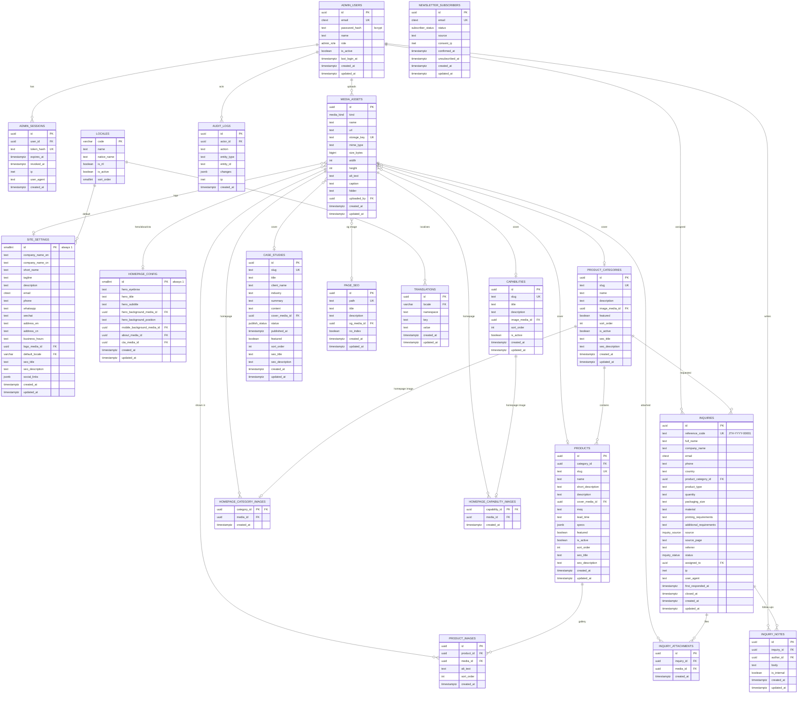

# Entity–relationship diagram

PostgreSQL 16 schema in `schema.sql`; the Prisma mirror is `prisma/schema.prisma`.
Enums: `admin_role`, `media_kind`, `publish_status`, `inquiry_status`,
`inquiry_source`, `subscriber_status`.

## Relationship notes

- `site_settings` and `homepage_config` are singleton tables (`id = 1`, enforced by `CHECK`).
- All child rows are removed with their parent where ownership is implied
  (`product_images`, `inquiry_notes`, `inquiry_attachments`, homepage join tables,
  `translations`, sessions). Catalogue parents use `RESTRICT`/`SET NULL` so a
  category cannot be deleted while products still reference it.
- `media_assets.storage_key` points at object storage; `url` is the public URL.
  Deleting a media row sets referencing content covers to `NULL` but does **not**
  delete the stored file — the backend must do that explicitly.
- Inquiries intentionally keep a snapshot of contact data even if a category or
  admin user is later deleted (`SET NULL`).
